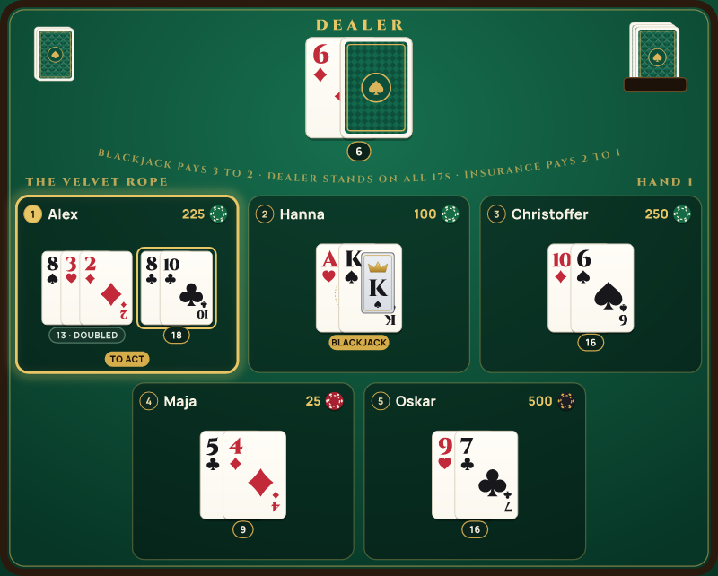
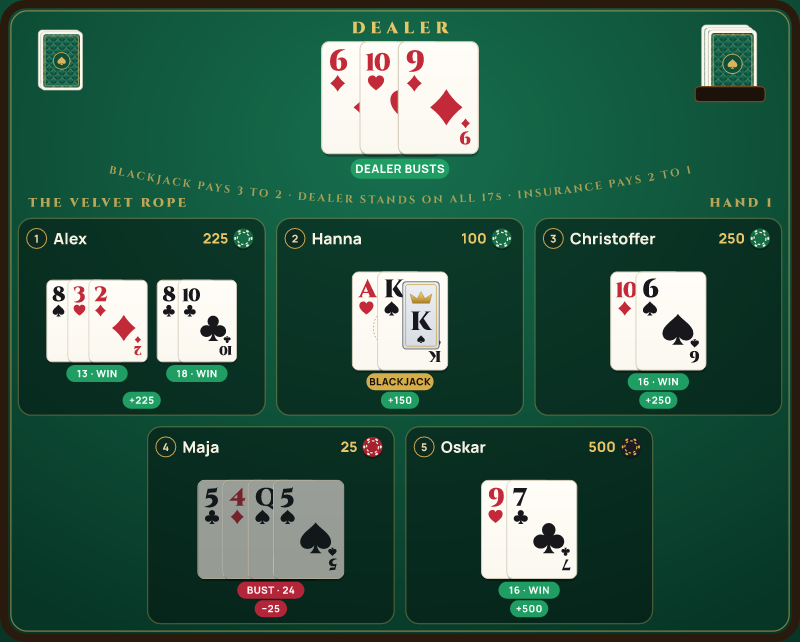
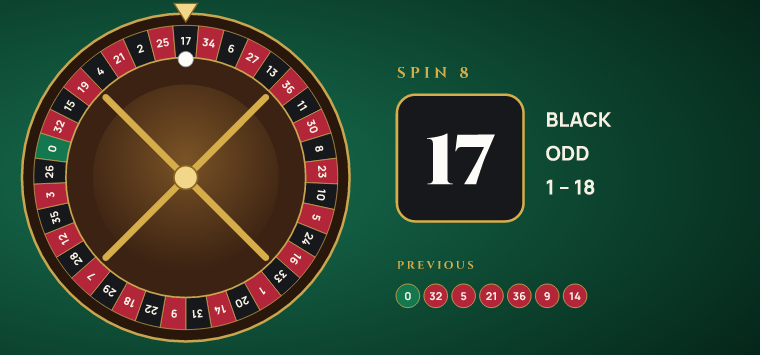

# The Emerald Room — a multiplayer Discord casino

A premium, button-driven casino for **private** Discord communities. Friends sit at real multiplayer
blackjack tables (each in its own thread), spin a shared roulette wheel, play a private slot machine
and challenge each other to coinflip duels — all with **free, fictional chips** that can never be
bought, sold or cashed out.



<table>
<tr>
<td></td>
<td></td>
</tr>
<tr>
<td></td>
<td></td>
</tr>
</table>

*All images are rendered by the bot itself (`npm run render-preview -- --docs`). The artwork —
cards, felt, chips, wheel, reels — is original vector art; fonts are Cinzel and Manrope (SIL OFL).*

---

## Contents

- [Features](#features)
- [Quick start](#quick-start)
- [Discord setup](#discord-setup)
- [Using the casino](#using-the-casino)
- [Commands](#commands)
- [Configuration](#configuration)
- [Test mode (one-channel allowlist)](#test-mode-one-channel-allowlist)
- [Multiplayer blackjack](#multiplayer-blackjack)
- [Blackjack house rules](#blackjack-house-rules)
- [Economy](#economy)
- [Persistence and restart recovery](#persistence-and-restart-recovery)
- [Testing](#testing)
- [Troubleshooting](#troubleshooting)
- [Project layout and extending](#project-layout-and-extending)
- [Policy and compliance](#policy-and-compliance)

Further reading: [Discord setup guide](docs/DISCORD_SETUP.md) · [Architecture](docs/ARCHITECTURE.md) ·
[Adding a game](docs/ADDING_A_GAME.md) · [Windows hosting](docs/WINDOWS_HOSTING.md) ·
[Feature checklist](docs/FEATURES.md) · [Compliance notes](docs/COMPLIANCE.md) · [Testing report](docs/TESTING_REPORT.md)

## Features

**Blackjack (flagship)**
- Real rules engine, independent of Discord: 6-deck shoe with a cryptographically secure shuffle,
  soft/hard totals, naturals, dealer peek, hit / stand / double / split (to 4 hands) / surrender,
  insurance, split-ace rules, configurable S17/H17, 3:2 or 6:5.
- **Multiple concurrent tables**, each with its own thread, dealer, shoe, seats, timers and panel.
  Five seats by default (1–7 configurable). Private tables with access codes.
- One persistent **table panel** per thread that updates in place: the table image (dealer, every
  hand, bets, the active player highlighted in gold), a status line, a short activity log and
  controls that change with the phase. Only the active player's clicks count; everyone else gets a
  discreet private explanation.
- Betting with chip buttons (presets derived from the table limits), rebet, custom amounts; the
  hand is dealt 20 s after the first bet, or 3 s after everyone is in.
- Turn timers shown as live Discord timestamps (no per-second edits), auto-stand on timeout,
  automatic sit-out for absent players, leave-after-this-hand, host tools (deal early, remove
  player, close table).
- Dealer reveal animation (one edit per dealer card, configurable), results with per-hand outcomes,
  achievements and level-ups.

**Casino**
- `/casino` home, wallet, transaction history, profile, achievements, cosmetics, leaderboards,
  daily missions, help — almost entirely clickable, in private (ephemeral) panels that update in
  place.
- A persistent public **lobby** message with live table list, quick seat, highlights. It survives
  restarts and recreates itself if deleted (never duplicates).
- **Roulette** (shared European wheel, 13 bet types), **Slots** (exact RTP 96.53%),
  **Coinflip duels** (escrowed stakes, accept/decline/cancel/expiry).
- Progression: XP and levels (separate from wealth, with a daily soft cap), 21 achievements,
  3 daily missions, unlockable card backs, table felts and titles — cosmetic only.
- Button-driven admin panel for every setting, audited wallet adjustments, health check.

**Engineering**
- TypeScript, Node.js 24, discord.js 14 with **Components V2**, SQLite via Node's built-in
  `node:sqlite` (no native build step on Windows), resvg for image rendering.
- Append-only ledger, escrowed wagers, idempotent operations, exactly-once settlement,
  deterministic restart recovery. **160 automated tests**, plus an end-to-end simulation.

## Quick start

Requirements: **Node.js 24+** (developed on Windows 11 with Node 24.13), a Discord application.

```powershell
git clone https://github.com/Stoffe101/Discord-Casino-Bot.git
cd Discord-Casino-Bot
npm install
copy .env.example .env      # then fill in DISCORD_TOKEN and DISCORD_CLIENT_ID
npm run register-commands   # registers slash commands (instant if DISCORD_DEV_GUILD_ID is set)
npm run dev                 # start with auto-reload
```

Then, in your server, run **`/casinoadmin setup`** in the channel you want as the casino lobby.

| Script | What it does |
| --- | --- |
| `npm run dev` | Run from source with auto-reload (tsx) |
| `npm run build` | Compile to `dist/` |
| `npm start` | Run the compiled bot (production) |
| `npm run register-commands` | Register slash commands (dev guild or global; see below) |
| `npm test` | Full test suite (headless; never connects to Discord) |
| `npm run typecheck` / `npm run lint` | Static checks |
| `npm run check` | typecheck + lint + test + build |
| `npm run simulate` | Headless multi-table simulation with timings and ledger audit |
| `npm run simulate:discord` | Multi-table run through the full Discord stack (in-memory Discord) |
| `npm run render-preview` | Render sample artwork to `render-preview/` |
| `npm run test:allowlist` | Find your dev server's `#casino` channel for [test mode](#test-mode-one-channel-allowlist) |
| `npm run live-bench` | Test mode only: validate every screen against the real Discord API in the allowlisted channel |
| `npm run reconcile` | Read-only ledger check of the database (run while the bot is stopped) |

> npm 11 may print an `allow-scripts` warning for `esbuild` (used by the dev runner). It is safe to
> ignore; nothing in this project needs install scripts.

## Discord setup

Full walkthrough with screenshots-in-words: **[docs/DISCORD_SETUP.md](docs/DISCORD_SETUP.md)**. In short:

1. Create an application at <https://discord.com/developers/applications>, add a **Bot**, copy the
   token into `.env` (`DISCORD_TOKEN`) and the Application ID (`DISCORD_CLIENT_ID`).
2. **No privileged intents are needed** — leave Presence, Server Members and Message Content off.
   The bot only uses the `Guilds` intent.
3. Invite it with the `bot` and `applications.commands` scopes and these permissions
   (integer `395137108992`): View Channel, Send Messages, Embed Links, Attach Files,
   Read Message History, Create Public Threads, Create Private Threads, Send Messages in Threads,
   Manage Threads.

   `https://discord.com/oauth2/authorize?client_id=YOUR_APP_ID&scope=bot+applications.commands&permissions=395137108992`
4. `npm run register-commands`. With `DISCORD_DEV_GUILD_ID` set, commands appear instantly in that
   server; without it they are registered globally (can take up to an hour).
5. Start the bot and run `/casinoadmin setup` in your casino channel.

## Using the casino

- **`/casino`** opens your private home: balance, passive income, daily reward, tables, games and
  navigation. Everything after that is buttons.
- **Play Blackjack** seats you at the busiest public table with a free seat (or opens one) and links
  you to its thread. Press a chip on the table to bet. When it's your turn the action buttons light up.
- **Spectate** any public table by opening its thread. Joining mid-hand deals you in next hand.
- The **lobby** (posted by `/casinoadmin setup`) lists live tables and gives one-click quick seat,
  wallet, daily reward, leaderboards and more. Its menus open privately, so the channel stays clean.

## Commands

| Command | Purpose |
| --- | --- |
| `/casino` | Casino home |
| `/wallet` · `/daily` | Wallet / claim the daily reward |
| `/blackjack` | Table browser: quick seat, open a table, join |
| `/roulette` · `/slots` | Go to the wheel / open your slot machine |
| `/coinflip <player> <stake> [call]` | Challenge someone to a duel |
| `/profile [player]` · `/leaderboard [board]` | Stats and rankings |
| `/help` | Topic-based help |
| User menu → **Apps → Casino profile** | Someone's profile |
| `/casinoadmin setup [channel]` | Post or move the lobby (Manage Server) |
| `/casinoadmin panel` | Settings panel |
| `/casinoadmin adjust <player> <amount> <reason>` | Audited wallet adjustment |
| `/casinoadmin audit` · `/casinoadmin health` | Audit log / ledger + bot health |
| `/casinoadmin reset-dev` | Development-only wipe (see below) |

`/casinoadmin` is hidden from members without **Manage Server**, and every admin action re-checks
that permission server-side.

## Configuration

**Environment** (`.env`, never committed):

| Variable | Default | Notes |
| --- | --- | --- |
| `DISCORD_TOKEN` | — | Bot token |
| `DISCORD_CLIENT_ID` | — | Application ID |
| `DISCORD_DEV_GUILD_ID` | empty | Register commands to this server instantly |
| `NODE_ENV` | `development` | `production` disables some dev-only checks |
| `DATABASE_PATH` | `./data/casino.db` | Created automatically |
| `LOG_LEVEL` | `info` | `trace`…`error` |
| `LOG_DIR` | `./logs` | Daily JSON-lines log files; empty = console only |
| `ALLOW_DEV_RESET` | `false` | Enables `/casinoadmin reset-dev` (dev server + development only) |

**Per-server settings** are edited in `/casinoadmin panel` and stored in the database — no code
changes needed. Defaults:

| Group | Setting (default) |
| --- | --- |
| General | Casino name (*The Emerald Room*), casino open (on) |
| Economy | Starting chips 1,000 · passive 50/h · passive cap 24 h · daily 250 · streak +25/day up to 7 days |
| Blackjack | Bets 10–500 · 5 seats · turn 30 s · betting window 20 s · insurance window 12 s · 6 decks · S17 · 3:2 · DAS on · surrender on · insurance on · split to 4 hands · no resplit aces · 75% penetration · reveal animation on |
| Tables | Max 6 open tables · threads on · close empty tables after 10 min · close tables without bets after 30 min |
| Other games | Coinflip 10–1,000, 120 s expiry · Roulette 10–500 per spot, 25 s window · Slots 5–250 |

## Test mode (one-channel allowlist)

For testing against a real server without risk to other channels, test mode restricts **every**
outgoing Discord action to one text channel:

```powershell
npm run test:allowlist -- --write   # finds the single #casino channel of DISCORD_DEV_GUILD_ID
```

This stores `CASINO_TEST_MODE=true`, `CASINO_TEST_GUILD_ID` and `CASINO_TEST_CHANNEL_ID` in `.env`. It refuses
to pick when there are zero or several matching channels. With test mode on:

- An outbound guard wraps the HTTP layer of the Discord client, so nothing can bypass it:
  handlers, panel updates, background jobs and scripts all go through it. It allows only:
  - messages in the allowlisted channel;
  - answers to interactions that came from that channel;
  - command registration for that server.
  
  Everything else is refused before it reaches the network, and the refusal is logged locally: other channels,
  threads, DMs, reactions, pins, channel or server settings, global commands, and any payload that
  could ping someone.
- Interactions from other channels or threads get no response at all.
- Threads are not used: table and roulette panels are posted in the allowlisted channel. Panels
  that already live in a thread are re-posted there on startup.
- `/casinoadmin setup` only works in the allowlisted channel. If no lobby is configured yet, the bot posts
  it there on startup.
- `npm run live-bench` shows every screen once through a single bot message, letting Discord's own API validate
  each payload, then deletes the message (`--keep` / `--cleanup` / `--only name`).

Remove the three lines from `.env` (or set `CASINO_TEST_MODE=false`) to return to normal operation.

## Multiplayer blackjack

- Every table has its **own** players, dealer, shoe, phase, timers, panel and thread. Tables never
  share state; each processes its actions one at a time through its own queue, while the database
  keeps money atomic across all of them. Ten friends can split across two five-seat tables (this
  exact scenario is an automated test), and the simulation runs 10+ tables concurrently.
- **One seat per player** across the whole server (enforced by a database unique constraint).
  Switch tables between hands; leaving mid-hand stands your remaining hands and frees the seat
  when the hand ends.
- **Phases:** betting → (insurance) → player turns → dealer → settlement → results, then betting
  reopens immediately; nobody needs to rejoin between hands.
- **Who can press what:** bet/rebet/clear act for whoever clicks. Hit/Stand/Double/Split/Surrender
  only work for the active player, and every button carries the round's sequence number, so a
  double-click or an old message can never act twice. Double/Split show as disabled when the rules
  don't allow them or the player can't afford them.
- **Timers:** the deadline is shown as a Discord relative timestamp. A 2-second grace period applies,
  then the hand stands. Two timeouts in a row, or two hands in a row without betting, sit a player
  out so the table isn't held up; betting again brings them back.
- **Threads:** tables live in `blackjack-table-NN` threads (private threads for private tables).
  If threads can't be created, the panel is posted in the casino channel instead. Idle tables close
  (never mid-hand), open bets are refunded and the thread is locked and archived.

## Blackjack house rules

Vegas-style defaults, all configurable:

- 6 decks, reshuffle at 75% penetration (cryptographically secure Fisher–Yates shuffle).
- Dealer **stands on all 17s** (H17 optional) and **peeks** for blackjack with an ace or ten up, so
  a dealer blackjack only ever takes the original bets.
- Blackjack pays **3:2** (6:5 optional). Wins pay 1:1, pushes return the stake.
- Double on any first two cards; **double after split** allowed.
- Split identical ranks up to **4 hands**; split aces get one card each and cannot be hit; aces are
  not resplit by default; 21 after a split is not a blackjack.
- **Late surrender** on the first two cards of an unsplit hand returns half the bet.
- **Insurance** when the dealer shows an ace: costs half the bet, pays 2:1. (Taking insurance with a
  natural is the "even money" equivalent.)
- The hand automatically stands at 21.
- **Rounding policy:** chips are integers; any fractional payout (3:2 on an odd bet, half-bet
  surrender/insurance) is **rounded down**. A 15-chip blackjack returns 37 (15 + 22).

## Economy

- Balances are integers and can't go negative (validated in code and by `CHECK` constraints).
- **Ledger:** every change is an immutable row (database triggers reject updates/deletes) with a
  unique idempotency key. Invariant: `balance = SUM(ledger)` per player — verified by tests, by an
  hourly self-audit, and by `/casinoadmin health`.
- **Escrow:** a bet moves chips from *available* to *committed* the moment it's placed. Doubles,
  splits and insurance escrow more. Committed chips can't be spent elsewhere. Settlement releases
  escrow and credits the payout in the same transaction.
- **Passive income** is computed from a timestamp (no background timers), capped, keeps fractional
  progress between claims, and can't be double-claimed.
- **Daily reward** uses UTC calendar days (no timezone tricks) with a streak bonus.
- **Transaction types:** welcome chips, passive earnings, daily reward, mission and achievement
  rewards, wager, bet withdrawn, win / push / settled, refund, admin adjustment.
- XP and levels come from playing and goals — never from chip wealth — with a daily soft cap. Missions
  reward taking part, never bet size. Cosmetics never affect odds.

## Persistence and restart recovery

SQLite in WAL mode (`data/casino.db`). The full state of every table — including the shoe — is
saved in the **same transaction** as the money movement that changed it, and settlement is
exactly-once (round id primary key). What happens if the process stops:

| Stopped during… | After restart |
| --- | --- |
| Betting | Bets stay escrowed; a fresh betting window starts; the hand is dealt normally |
| Dealing | Dealing is atomic with locking the bets: either the hand exists (resumes) or the bets are still open |
| Insurance / player turns | The hand resumes **exactly** (same cards, same shoe); the current player gets a fresh timer |
| The action that ends a hand | Dealer play and settlement are part of that action's transaction: either everything committed, or the hand is back at that decision and continues |
| Settlement | Cannot be half-applied; cannot run twice |
| Unreadable/corrupt state | The round is voided and **every stake refunded** atomically; seats are kept |
| Orphaned wagers (no live round) | Refunded at startup |
| Coinflip challenge | Re-armed, or expired and refunded if overdue |
| Roulette spin | Bets kept and a new window starts; the spin itself is atomic |

Panels are re-rendered on startup; missing table messages or threads are recreated, and the lobby
message is edited in place (or re-posted if it was deleted). See [docs/ARCHITECTURE.md](docs/ARCHITECTURE.md).

> **Single process only — enforced.** The bot holds an operating-system lock tied to its database
> (a named pipe on Windows), and a second copy refuses to start (exit code 2) instead of running two
> bots against one database. The OS releases the lock whenever the process ends — even after a
> crash or hard kill — so there is never a stale lock to clean up.

## Testing

```powershell
npm test                  # 240 tests, ~15 s, fully headless (never connects to Discord)
npm run check             # typecheck + lint + tests + build
npm run simulate          # engine level, e.g. -- --tables 12 --players 5 --rounds 15 --crash
npm run simulate:discord  # full Discord stack, e.g. -- --tables 12 --players 5 --rounds 3 --latency 40
```

**Full-stack harness.** `tests/harness/` runs the real bot — discord.js client, outbound guard,
router, panel sync — against an in-memory Discord (`FakeDiscord`). Interactions are injected as raw
gateway payloads through discord.js itself, and simulated players can only press buttons that are
visible and enabled on messages they can see. The fake enforces the 3-second acknowledgement
deadline, one acknowledgement per interaction, ephemeral visibility and modal field rules, and
rejects invalid payloads (Components V2 limits, duplicate custom ids, `attachment://` references
that don't resolve). Scenarios cover blackjack end to end (controls per turn, wrong-turn and
double/stale clicks, split, surrender, naturals, insurance, timeouts, leaving mid-hand, private
tables, host-only controls), the economy, slots, roulette, coinflip, crash-and-resume on the same
message, render ordering under latency, deleted panels, Discord 5xx errors, two servers on one bot,
and 10/2 and 20/4 player/table runs. The harness's validation is a model of Discord's rules, so
real acceptance is checked separately with `npm run live-bench` (test mode).

The suite covers card values, every rule and payout (including a 3,000-round randomised invariant
test), shoe exhaustion, ten players on two concurrent tables with simultaneous clicks, double-clicks
and stale buttons, escrow and ledger invariants, concurrent claims, crash/restart at every phase,
corrupt state, orphan refunds, exact slot RTP by enumeration, roulette odds, coinflip races and
expiry, UI payloads against Discord's limits (40 components, 10 per container, 4,000 characters,
custom-id rules, attachments), discord.js's own serializer on our raw V2 payloads, ids from other
servers being refused, and the interaction router driven by fake interactions.

Local measurements (Windows 11, Node 24.13):

| Run | Result |
| --- | --- |
| `simulate -- --tables 2 --players 5 --rounds 20` (10 players) | 40 hands; service actions avg ~2 ms (p95 ~6 ms); panel render incl. image avg ~65 ms |
| `simulate -- --tables 12 --players 5 --rounds 15 --crash` (60 players, crash + recovery mid-run) | 180 hands settled in 35 s; ledger reconciled; chips conserved; 0 open escrows. With all 12 tables acting at the same instant: actions avg 13 ms (p95 32 ms, includes queueing), panel renders avg 132 ms (p95 233 ms — renders share libuv's default 4-thread pool) |

| `simulate:discord -- --tables 12 --players 5 --rounds 3 --latency 40` (full Discord stack) | 36 hands, 472 interactions, all acknowledged (p95 440 ms with 40 ms simulated latency per request); ledger reconciled; chips conserved |
| `live-bench` against the real Discord API (33 screens, one message edited) | All accepted; median request 429 ms; edits in one channel are rate-limited by Discord to about 5 per 5 s |

Table images are ~150–190 KB. Real-client behaviour that needs a human (pressing buttons as a
player, mobile rendering) is listed as unverified in [docs/TESTING_REPORT.md](docs/TESTING_REPORT.md).

## Troubleshooting

| Symptom | Fix |
| --- | --- |
| `Configuration problem: DISCORD_TOKEN is not set` | Copy `.env.example` to `.env` and fill it in |
| `Another casino bot is already running against ./data/casino.db` | A copy is already running (another terminal, `npm run dev`, or the Windows runner). Stop it first |
| Nothing happens outside one channel | Test mode is on (`CASINO_TEST_MODE=true`); see [Test mode](#test-mode-one-channel-allowlist) |
| Slash commands don't appear | Run `npm run register-commands`; set `DISCORD_DEV_GUILD_ID` for instant registration; global commands can take up to an hour |
| "Missing permissions" on setup | Grant the permissions listed above in the casino channel (check channel overrides) |
| Tables are posted as channel messages, not threads | The bot lacks Create Public/Private Threads or Send Messages in Threads in that channel |
| "This interaction failed" | Check the console/log; the bot acknowledges within Discord's 3 s window, so this usually means the bot was offline or lacks access to the channel |
| A table panel was deleted | Interact with the table (e.g. Quick seat) — the panel is recreated automatically |
| Ledger warnings in the log | Run `/casinoadmin health`; please report it with the log file |
| `allow-scripts` warning during `npm install` | Harmless (esbuild, used only by the dev runner) |

## Project layout and extending

```
src/
  app/            composition root (no Discord)
  config/         env parsing, per-server settings schema + defaults
  core/           logger, clock, CSPRNG, keyed queues, scheduler, errors, formatting
  db/             node:sqlite wrapper (transactions/savepoints), migrations
  domain/         economy + ledger, stats, progression, achievements, missions,
                  leaderboards, round recorder (exactly-once settlement), settings
  games/          blackjack engine, roulette, slots, coinflip (pure rules + services)
  tables/         multiplayer blackjack table service, view model, types
  render/         SVG artwork → PNG (cards, table, banner, wheel, reels, coin)
  ui/             Components V2 kit, validator, custom ids, every screen
  discord/        client, router, panel render queues, lobby, commands, payloads
  scripts/        command registration, simulation, render preview
tests/            vitest suites (headless)
```

To add a game, implement its rules as a pure module, escrow wagers with `EconomyService.reserve`,
and settle with `RoundRecorder.record` — that one call pays out, updates stats, streaks, XP,
missions, achievements and leaderboards. Screens reuse the UI kit. Walkthrough:
[docs/ADDING_A_GAME.md](docs/ADDING_A_GAME.md). Tournaments are a planned extension; see
[docs/FEATURES.md](docs/FEATURES.md).

## Policy and compliance

The chips are **fictional and non-transferable**: they can't be bought, sold, traded, cashed out or
redeemed for anything of value, and there are no payments or crypto anywhere in this project.
Discord's [Developer Policy](https://support-dev.discord.com/hc/en-us/articles/8563934450327)
prohibits facilitating illegal gambling; its
[App Discovery content requirements](https://support-dev.discord.com/hc/en-us/articles/9489299950487)
exclude "gambling-adjacent" apps, and its
[Monetization Policy](https://support.discord.com/hc/en-us/articles/10575066024983) prohibits
monetizing simulated casinos. This bot is therefore intended for **private servers only**: do not
list it in App Discovery and do not monetize it. Details: [docs/COMPLIANCE.md](docs/COMPLIANCE.md).
